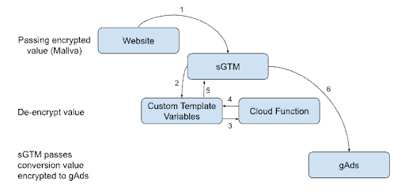

<!--
 Copyright 2026 Google LLC
 Licensed under the Apache License, Version 2.0 (the "License");
 you may not use this file except in compliance with the License.
 You may obtain a copy of the License at
      https://www.apache.org/licenses/LICENSE-2.0
 Unless required by applicable law or agreed to in writing, software
 distributed under the License is distributed on an "AS IS" BASIS,
 WITHOUT WARRANTIES OR CONDITIONS OF ANY KIND, either express or implied.
 See the License for the specific language governing permissions and
 limitations under the License.
-->

# 🚀 Harpocrates 🚀

Welcome! This guide will walk you through deploying and configuring the sGTM Profit Template. This template allows you to securely pass an AES-256 encrypted value to your sGTM container and decrypt it via an IAM-authenticated Google Cloud Function, enhancing your data privacy and security.

Let's get started!

## 🏗️ Architecture

The following diagram illustrates the flow of data with this setup:



Here's a step-by-step breakdown of how the data flows through the system:

1.  **Encrypted Value Sent to sGTM**: An AES-256 encrypted value is passed to the sGTM server within the `encryptedValueEventData` parameter of the incoming request.
2.  **Template Finds Encrypted Value**: The custom variable template in your sGTM container is triggered and reads the `encryptedValueEventData` from the event data.
3.  **Template Mints an OIDC ID Token**: Using `getGoogleAuth` and the Google Cloud IAM Service Account Credentials API (`iamcredentials.googleapis.com`), the template mints a Google-signed OpenID Connect (OIDC) ID token scoped to your Cloud Function URL.
4.  **Template Sends Authenticated Request to Cloud Function**: The template sends the encrypted value along with `Authorization: Bearer <ID_TOKEN>` to the deployed Google Cloud Function (`--no-allow-unauthenticated`).
5.  **Cloud Function Verifies & Decrypts**: Cloud Functions IAM verifies the caller's identity and `roles/cloudfunctions.invoker` (and `roles/run.invoker`) permissions, and the function uses the secret key to decrypt the value and return the plaintext result to the template.
6.  **Template Returns Decrypted Value**: The template receives the decrypted value from the Cloud Function and makes it available as a number within the sGTM environment.
7.  **Value Reported to Google Ads**: The decrypted value can now be used in other tags, such as the Google Ads conversion tag, to report the accurate conversion value.

---

## ✅ Prerequisites

Before you begin, please ensure you have the following:

*   A Google Cloud project with billing enabled.
*   The `gcloud` CLI installed and authenticated.
*   A GTM server container (sGTM) up and running on Google Cloud (e.g., Cloud Run or App Engine), and receiving events from a GTM web container.
*   It is recommended to have all the components in the same cloud region to reduce network latency.

---

## 🛠️ Setup & Deployment (New Installations)

Follow these steps to get everything up and running.

### 1. Clone the Repository

First, clone this repository:

```bash
git clone https://github.com/google-marketing-solutions/gps-sgtm-pantheon.git
cd gps-sgtm-pantheon/sgtm/harpocrates
```

### 2. Configure Environment Variables

Copy the example environment file to create your own configuration:

```bash
cp .env.example .env
```

Open `.env` and fill in your encryption keys:

*   `DECRYPTION_KEY`: 64-character hex string (32 bytes), e.g. generated with `openssl rand -hex 32`.
*   `IV`: 32-character hex string (16 bytes), e.g. generated with `openssl rand -hex 16`.
*   *(Optional)* `SGTM_SERVICE_ACCOUNT`: Leave blank to let `./deploy.sh` automatically detect the Service Account running your sGTM Cloud Run service.

### 3. Set Your GCP Region

Open the `deploy.sh` script (or set `REGION` in `.env`) to your desired Google Cloud region (e.g., `us-central1`). This ensures the Cloud Function is deployed to the correct location.

```bash
# deploy.sh
REGION="us-central1"
```

### 4. Deploy the Cloud Function

Make the deployment script executable and run it:

```bash
chmod +x deploy.sh
./deploy.sh
```

`deploy.sh` automatically:
1.  Detects the Service Account running your sGTM Cloud Run container and pre-fills it into `encryptedValue.tpl`.
2.  Enables the `iamcredentials.googleapis.com`, `cloudfunctions.googleapis.com`, and `run.googleapis.com` APIs.
3.  Grants your sGTM Service Account the `roles/iam.serviceAccountOpenIdTokenCreator` role so it can mint OIDC ID tokens.
4.  Deploys the `decryptValue` Cloud Function with `--no-allow-unauthenticated` (blocking all unauthenticated internet traffic).
5.  Grants your sGTM Service Account the `roles/cloudfunctions.invoker` and `roles/run.invoker` roles on `decryptValue`.

### 5. Upload the Template to sGTM

Add the custom variable template to your sGTM container:

1.  Navigate to your sGTM container in the Google Tag Manager interface.
2.  Go to the **Templates** section in the left-hand menu.
3.  Under **Variable Templates**, click **New**.
4.  Click the three dots (**⋮**) in the top-right corner and select **Import**.
5.  Select the `encryptedValue.tpl` file from this project and click **Save**.

### 6. Create a Variable & Configure Your Tag in sGTM

1.  Go to the **Variables** section and click **New** under **User-Defined Variables**.
2.  Choose the **AES-256 Decryptor Variable** template you just imported.
3.  Fill in the variable parameters (`Google Cloud Project ID`, `Cloud Function Region`, `Cloud Function Name`, and `Default Value`).
4.  Save the variable, reference it in your conversion tag (e.g., Google Ads Conversion Tracking), and **Publish** your container.

---

## 🔄 Migrating from v1 (Unauthenticated) to v2 (Authenticated)

If you are already running an earlier version of Harpocrates, upgrading requires **only 2 steps** (your `DECRYPTION_KEY`, `IV`, website encryption code, and existing sGTM Variable settings stay untouched):

### Step 1: Run `./deploy.sh`

Pull the latest code in your `harpocrates` folder and run the deployment script:

```bash
./deploy.sh
```

The script automatically reads your existing `.env`, detects your sGTM Cloud Run Service Account, configures all required Google Cloud IAM permissions, redeploys `decryptValue` with `--no-allow-unauthenticated` (removing public `allUsers` access), and pre-populates your Service Account email inside `encryptedValue.tpl`.

### Step 2: Re-Import `encryptedValue.tpl` in sGTM and Publish

1.  In your sGTM container in Google Tag Manager, go to **Templates** → click **AES-256 Decryptor Variable**.
2.  Click the three dots (**⋮**) in the top-right corner → select **Import** → choose the updated `encryptedValue.tpl` file → click **Save**.
3.  Click **Submit** → **Publish** to publish your container.
    *(No changes are needed on your existing Variable—it automatically uses the pre-populated Service Account and reads `encryptedValueEventData` from the incoming event.)*

---

## 🧪 Test Your Setup

After publishing your container, you can test the setup by sending a request to your sGTM endpoint to verify that the encrypted value is being decrypted end-to-end.

Construct a URL like the one below, replacing the placeholders with your specific values:

```
https://server-side-tagging-193100055804.${sGTM_REGION}.run.app/g/collect?v=2&tid=G-4C3C4XJ4CH&cid=12345.67890&en=encrypt&encryptedValueEventData=${ENCRYPTED_VALUE}&_dbg=1
```

**Placeholders:**

*   `${sGTM_REGION}`: The GCP region where your sGTM container is hosted.
*   `${ENCRYPTED_VALUE}`: The URL-encoded base64 encrypted value you want to send.

You can use the sGTM debugger (`_dbg=1`) to see the incoming request and verify that your tag is firing as expected.

🎉 **You're all set!** Your sGTM container is now securely working with encrypted values.
